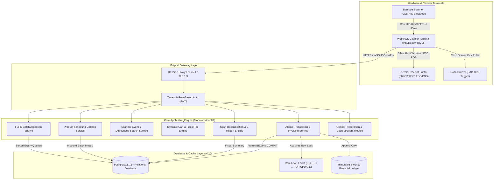
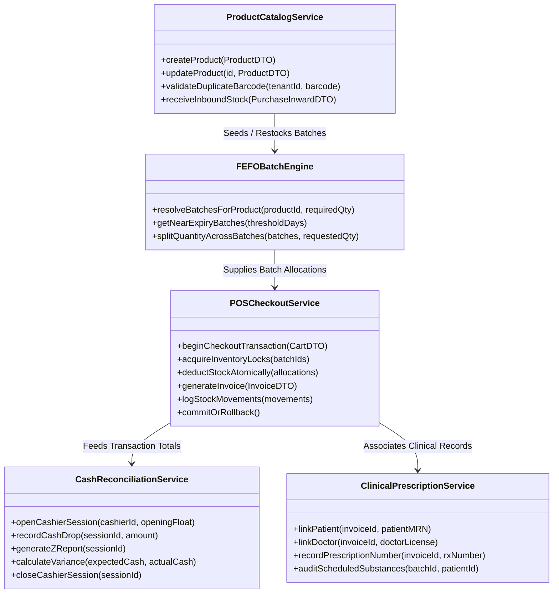
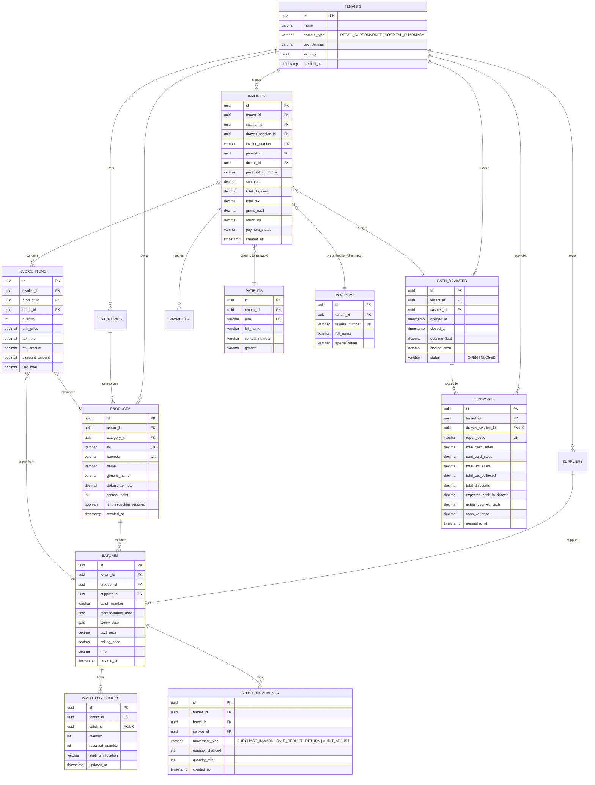
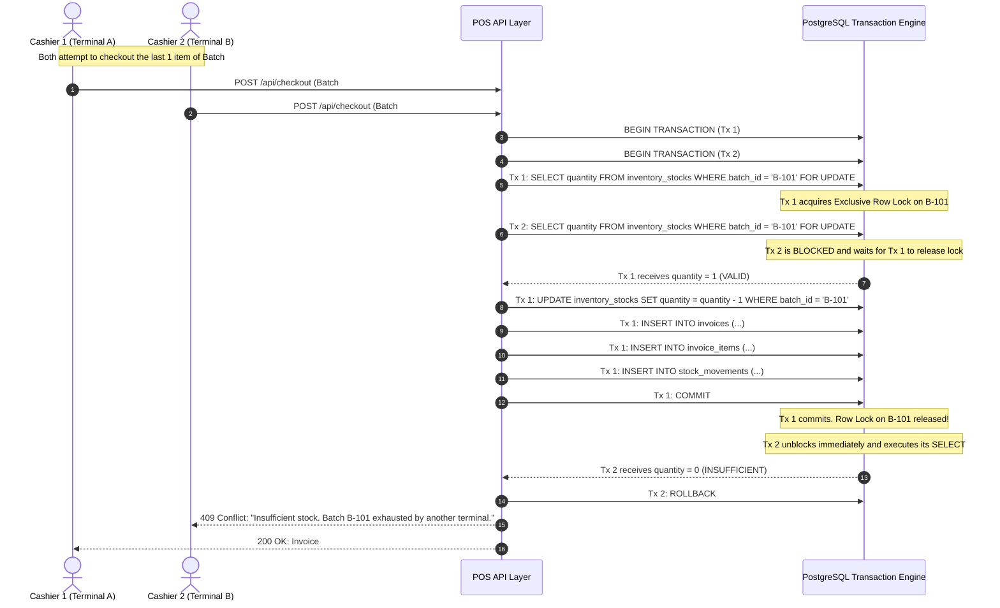
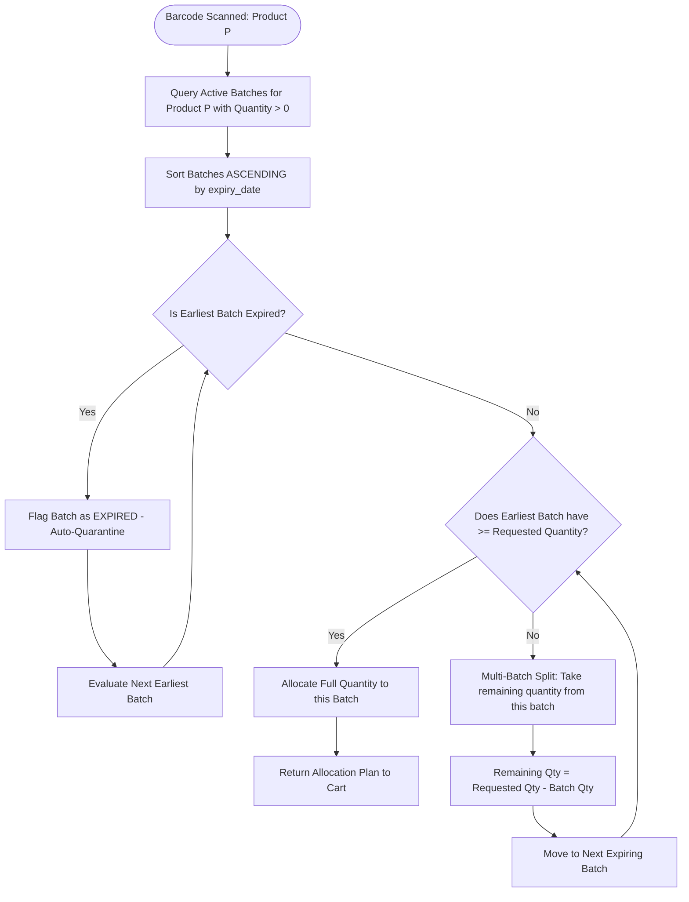
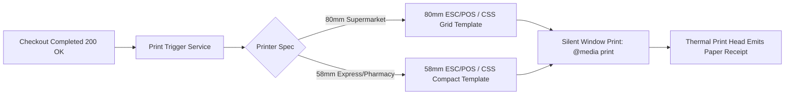

# System Architecture & Technical Specifications
## Enterprise Multi-Tenant POS & Inventory Management SaaS

[](file:///e:/OJT's%20task/ARCHITECTURE.md)
[](file:///e:/OJT's%20task/DATABASE_SCHEMA.sql)
[](file:///e:/OJT's%20task/ARCHITECTURE.md#5-concurrency-control--transaction-safety)

---

## 1. High-Level Architectural Overview

The system is designed as a **Modular Monolith** with strict Domain-Driven Design (DDD) boundaries. It is optimized for ultra-low latency cashier interactions (`< 150ms` scan-to-cart ingestion), high-concurrency atomic checkout pipelines, and domain specialization across Supermarket Retail and Hospital Pharmacy workflows.

### System Topology Diagram



---

## 2. Multi-Tenant Architecture & Data Isolation

The application implements a **Shared Database, Tenant-Discriminator Column** architecture with **PostgreSQL Row-Level Security (RLS)** as an optional defense-in-depth enforcement:

1. **Tenant Identification:**
   - Every operational entity (`products`, `batches`, `inventory_stocks`, `invoices`, `categories`, `z_reports`) contains a mandatory `tenant_id (UUID)` foreign key.
   - All database indexes enforce tenant scope: e.g., `UNIQUE (tenant_id, barcode)` ensures Barcode `"8901234567890"` is unique within Tenant A without conflicting with Tenant B.
2. **Context Propagation:**
   - Requests provide tenant context via JWT claims (`x-tenant-id`).
   - The application context extracts the tenant and binds it to database transactions via session variables (`SET LOCAL app.current_tenant_id = '...'`).
3. **Domain Tenant Modes:**
   - `RETAIL_SUPERMARKET`: Standard cashier layout, promotions, loyalty points, multi-pack bundles, Z-report balancing.
   - `HOSPITAL_PHARMACY`: FEFO automatic batch selection, narcotic prescription control, Patient MRN and Doctor tagging, batch recall capabilities.

---

## 3. Domain-Driven Service Boundaries



---

## 4. Entity Relationship Diagram (ERD)



---

## 5. Concurrency Control & Transaction Safety

### The "Double-Spend" Problem at the POS Counter
In a bustling supermarket or pharmacy, Counter #1 and Counter #2 may scan the **exact same last remaining unit** of product (Stock = 1) at the exact same millisecond.
- Without database-level isolation, both cashiers query `quantity = 1`.
- Both proceed to deduct 1 unit.
- Stock becomes `0` or negative `-1`, leading to stock shrinkage, inventory discrepancy, and legal compliance breaches (especially in pharmacy controlled substances).

### Pessimistic Row-Level Locking Architecture
The system avoids optimistic locking retry loops (which degrade cashier checkout speed) by implementing **Pessimistic Row-Level Locks (`SELECT ... FOR UPDATE`)**:



### Deadlock Prevention via Deterministic Sort Order
When a customer purchases multiple items spanning multiple batches (e.g., Batch X, Batch Y, Batch Z), concurrent transactions locking items in random order can result in database deadlocks.
- **Rule:** The checkout engine **MUST** sort all requested `batch_id` values in ascending lexicographical order prior to acquiring row locks:
```sql
-- Always locked in sorted order to guarantee zero deadlocks
SELECT batch_id, quantity 
FROM inventory_stocks 
WHERE batch_id IN ('batch-001', 'batch-004', 'batch-019') 
ORDER BY batch_id ASC 
FOR UPDATE;
```

---

## 6. First-Expired, First-Out (FEFO) Engine

In hospital pharmacies and perishable retail goods, selling near-expiry stock first is required to minimize wastage and comply with health regulations.

### FEFO Resolution Flowchart



### Multi-Batch Split Scenario Example
- Customer requests **15 tablets** of *Amoxicillin 500mg*.
- Available Batches:
  - `Batch A-101` (Expires: **15-Nov-2026**): **6 tablets** in stock.
  - `Batch B-202` (Expires: **20-Jan-2027**): **20 tablets** in stock.
- **FEFO Engine Decision:**
  - Split Line Item into 2 allocations:
    - 6 tablets from `Batch A-101` (clearing old stock)
    - 9 tablets from `Batch B-202`
- Thermal receipt explicitly prints batch numbers and respective expiry dates per line item for patient safety and regulatory audit.

---

## 7. Hardware Scanner & Latency Optimization

### Latency Budget Breakdown (< 150ms Ingestion)

| Step | Operation | Target Latency | Optimization Technique |
| :---: | :--- | :---: | :--- |
| **1** | Scanner Keystroke Stream Buffer | `20ms` | Buffer characters with `< 30ms` delta; trigger upon `Enter`. |
| **2** | Barcode Lookup (Memory / Local DB) | `15ms` | B-tree index `UNIQUE (tenant_id, barcode)`; Redis hot cache. |
| **3** | Dynamic Cart State Calculation | `10ms` | Client-side immutable state update using integer cents math. |
| **4** | UI DOM Render & Audio Beep Feedback | `15ms` | Synthetic Web Audio API beep; CSS transform animations. |
| **Total** | **End-to-End Item Ingestion** | **~60ms** | **Well under the 150ms benchmark!** |

---

## 8. Financial Reconciliation & Z-Report Architecture

At the end of a cashier's shift, the system executes an automated cash balancing routine:
1. **Drawer Session Opening:** Cashier logs in, enters opening float (e.g., `$150.00`). Status is marked `OPEN`.
2. **Operational Sales Ingestion:** All cash, card, credit, and digital wallet transactions append to the session.
3. **Mid-Shift Cash Drops:** Cashiers drop surplus cash into a safe to minimize counter robbery risk.
4. **Register Closure (Z-Report Generation):**
   - System calculates:
     $$\text{Expected Cash} = \text{Opening Float} + \text{Total Cash Sales} - \text{Cash Drops} - \text{Cash Refunds}$$
   - Cashier enters physical cash count (blind count without seeing expected total).
   - System calculates variance:
     $$\text{Variance} = \text{Counted Cash} - \text{Expected Cash}$$
   - Any variance $> 0$ (Over) or $< 0$ (Short) is recorded with an audit reason.
   - The drawer session is permanently marked `CLOSED`. No further invoices can be attached to this session.

---

## 9. Thermal Print Subsystem (80mm & 58mm)



- **Zero External Plugin Dependency:** Uses standard `@media print` with CSS dimensions `@page { size: 80mm auto; margin: 0; }`.
- **High-Density Typography:** Monospace fonts (`Courier New`, `Consolas`, `Roboto Mono`) guarantee strict columnar alignment across currency and quantity fields.
- **ESC/POS Command Emulation:** Supports raw network printing over port 9100 with ESC/POS hex codes (`ESC @`, `GS V 1` for paper cut, `DLE DC4` for cash drawer kick).
