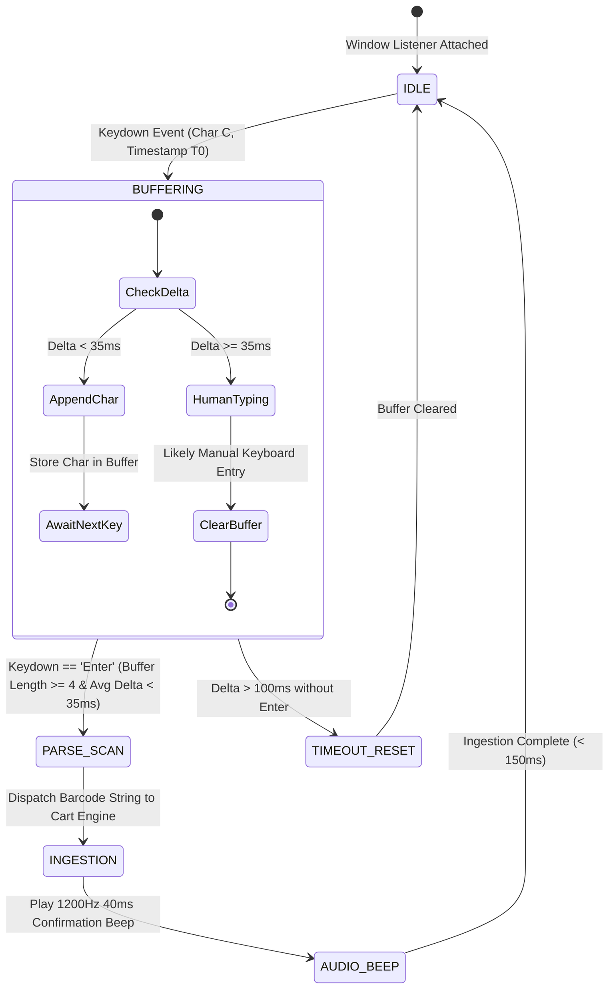

# UI/UX & System Design Specification
## Enterprise POS & Inventory Management SaaS
### Powered by UI-UX Pro Max Design Intelligence

[](file:///e:/OJT's%20task/design-system/enterprise-pos/MASTER.md)
[-emerald.svg)](file:///e:/OJT's%20task/DESIGN.md#1-design-system--tokens)
[](file:///e:/OJT's%20task/DESIGN.md#7-accessibility--keyboard-shortcuts)

---

## 1. Design System & Tokens

Following the **UI-UX Pro Max** design recommendation for high-density enterprise SaaS and medical POS environments:
- **Style Archetype:** Modern Flat / High-Contrast Ergonomic Dashboard
- **Color Palette Mood:** Pharmacy Green (`#15803D`) + Trust Navy (`#0369A1`) + Slate Neutral (`#0F172A`)
- **Visual Ergonomics:** Optimized for 8+ hour cashier shifts under fluorescent store lighting to minimize eye fatigue.

### Design Tokens & CSS Custom Properties

```css
:root {
  /* Brand & Core Color Palette */
  --color-primary: #15803D;             /* Primary Green (Health, Success) */
  --color-primary-hover: #166534;
  --color-on-primary: #FFFFFF;
  --color-secondary: #22C55E;           /* Vibrant Green Accent */
  --color-on-secondary: #0F172A;
  --color-accent: #0369A1;              /* Trust Navy (Retail/Admin) */
  --color-accent-hover: #075985;
  --color-on-accent: #FFFFFF;

  /* Neutrals & Surfaces */
  --color-background: #0F172A;          /* Deep Slate / Dark Cashier Theme */
  --color-surface: #1E293B;             /* Elevated Card / Panel Surface */
  --color-surface-hover: #334155;
  --color-border: #334155;
  --color-foreground: #F8FAFC;          /* High Contrast White Text */
  --color-muted: #64748B;
  --color-muted-foreground: #94A3B8;

  /* State Alerts */
  --color-destructive: #DC2626;         /* Red (Expired Batch / Insufficient Stock) */
  --color-on-destructive: #FFFFFF;
  --color-warning: #F59E0B;             /* Amber (Near Expiry < 30 Days / ROP Reorder) */
  --color-warning-foreground: #78350F;
  --color-success: #10B981;             /* Scan Valid / Transaction Committed */

  /* Typography Scales */
  --font-sans: 'Nunito Sans', 'Rubik', -apple-system, BlinkMacSystemFont, sans-serif;
  --font-mono: 'JetBrains Mono', 'Consolas', 'Roboto Mono', monospace;

  /* High-Density Layout Spacing (Density 8/10) */
  --space-2xs: 4px;
  --space-xs: 8px;
  --space-sm: 12px;
  --space-md: 16px;
  --space-lg: 20px;
  --space-xl: 24px;
  --space-2xl: 32px;

  /* Border Radii */
  --radius-sm: 4px;
  --radius-md: 8px;
  --radius-lg: 12px;
  --radius-full: 9999px;

  /* Transitions */
  --transition-fast: 150ms cubic-bezier(0.4, 0, 0.2, 1);
  --transition-normal: 250ms cubic-bezier(0.4, 0, 0.2, 1);
}
```

---

## 2. POS Cashier Counter Screen Layout

The POS Cashier interface utilizes an asymmetrical **65/35 High-Throughput Split Screen Layout**:

```
+-------------------------------------------------------------------------------------------------------------+
|  [LOGO] ENTERPRISE POS  | Tenant: [St. Jude Pharmacy v] | Drawer #01 (OPEN) | Cashier: Sarah J. | [● SCANNER READY] |
+-------------------------------------------------------------------------------------------------------------+
|  [🔍 Scan Barcode or Type Product / SKU (F2)...                                  ] [⚡ FEFO Mode: ACTIVE]   |
+--------------------------------------------------------------------+----------------------------------------+
|  LIVE CART (6 Items)                             [Clear Cart (Esc)]|  COMMAND DECK (Totals & Tender)         |
+--------------------------------------------------------------------+----------------------------------------+
|  ITEM                       BATCH     EXPIRY       QTY  UNIT   TAX |  SUBTOTAL:                    $128.50  |
+--------------------------------------------------------------------+  DISCOUNT (10%):              -$12.85  |
|  Amoxicillin 500mg (10's)   #B-902    18-Nov-2026   2   $12.50  5% |  TAX (VAT 5%):                 $5.78  |
|  [FEFO: Earliest Expiry Batch Auto-Allocated]             Line: $25.00 |  ROUND OFF:                    -$0.03  |
+--------------------------------------------------------------------+----------------------------------------+
|  Paracetamol 650mg          #P-104    04-Jan-2027   1   $ 6.00  0% |  GRAND TOTAL:                 $121.40  |
|                                                           Line: $ 6.00 |  (Items: 3 | Total Qty: 4 units)       |
+--------------------------------------------------------------------+----------------------------------------+
|  Cough Syrup 100ml          #C-441    12-Dec-2026   1   $15.00  5% |  [ 🏥 CLINICAL PATIENT / RX TAGGING  ] |
|  [⚠️ Near Expiry Warning: 58 Days Remaining]              Line: $15.00 |  Patient MRN: [MRN-884920          ] |
+--------------------------------------------------------------------+  Prescription #: [RX-991048          ] |
|                                                                    |  Doctor: [Dr. Robert Adams, MD     ] |
|                                                                    +----------------------------------------+
|                                                                    |  QUICK CASH TENDER:                    |
|                                                                    |  [ $20 ]  [ $50 ]  [ $100 ] [ EXACT ]  |
|                                                                    +----------------------------------------+
|                                                                    |  PAYMENT METHOD:                       |
|                                                                    |  [● CASH]   [○ CARD]   [○ UPI / QR]    |
|                                                                    +----------------------------------------+
|                                                                    |  [      COMPLETE CHECKOUT (F12)       ] |
|                                                                    |  [ 🖨️ Thermal Print & Drawer Open    ] |
+--------------------------------------------------------------------+----------------------------------------+
|  STATUS: Connected to DB (Ping: 4ms) | Last Scan: #8901234567890 (Ingestion: 42ms) | Keyboard Shortcuts (F1)     |
+-------------------------------------------------------------------------------------------------------------+
```

---

## 3. Hardware Barcode Scanner State Machine

### Inter-Keystroke Timing Engine
To intercept rapid hardware scanner streams without demanding continuous focus on an `<input>` element:



### Reference Scanner Buffer Implementation (TypeScript)
```typescript
export class BarcodeScannerListener {
  private buffer: string = '';
  private lastKeyTime: number = 0;
  private readonly maxInterKeyDeltaMs = 35; // Hardware scanners emit chars every 5-25ms
  private readonly minBarcodeLength = 4;
  private onScanCallback: (barcode: string) => void;

  constructor(onScan: (barcode: string) => void) {
    this.onScanCallback = onScan;
    this.initListener();
  }

  private initListener(): void {
    window.addEventListener('keydown', (e: KeyboardEvent) => {
      const now = performance.now();
      const delta = now - this.lastKeyTime;
      this.lastKeyTime = now;

      // Handle scanner completion suffix (Enter key)
      if (e.key === 'Enter') {
        if (this.buffer.length >= this.minBarcodeLength) {
          e.preventDefault();
          const scannedCode = this.buffer.trim();
          this.buffer = '';
          this.onScanCallback(scannedCode);
        } else {
          this.buffer = '';
        }
        return;
      }

      // Check if keystroke is fast enough to be a hardware scanner
      if (delta < this.maxInterKeyDeltaMs || this.buffer.length === 0) {
        if (e.key.length === 1) { // Alphanumeric characters
          this.buffer += e.key;
        }
      } else {
        // Slow keystroke: human typing. Reset buffer and preserve individual key
        this.buffer = e.key.length === 1 ? e.key : '';
      }
    });
  }
}
```

---

## 4. Real-Time Cart Calculation & Currency Precision Engine

To prevent IEEE-754 floating-point inaccuracies (e.g., `0.1 + 0.2 = 0.30000000000000004`), all internal currency calculations are processed in **Integer Cents** (or Decimal-safe units) before display formatting:

### Calculation Formula Hierarchy

1. **Line Item Subtotal:**
   $$\text{Line Gross} = \text{Quantity} \times \text{Unit Price}$$
2. **Line Item Discount:**
   $$\text{Line Discount} = \text{Line Gross} \times \left(\frac{\text{Discount \%}}{100}\right) + \text{Fixed Discount}$$
3. **Line Taxable Amount:**
   $$\text{Taxable Base} = \text{Line Gross} - \text{Line Discount}$$
4. **Line Tax (VAT / Sales Tax):**
   $$\text{Line Tax} = \text{Round}\left(\text{Taxable Base} \times \frac{\text{Tax Rate \%}}{100}\right)$$
5. **Line Total:**
   $$\text{Line Total} = \text{Taxable Base} + \text{Line Tax}$$
6. **Cart Grand Total & Round-Off:**
   $$\text{Subtotal} = \sum \text{Line Gross}$$
   $$\text{Total Tax} = \sum \text{Line Tax}$$
   $$\text{Total Discount} = \sum \text{Line Discount} + \text{Cart Discount}$$
   $$\text{Raw Grand Total} = \text{Subtotal} - \text{Total Discount} + \text{Total Tax}$$
   $$\text{Grand Total} = \text{Round}(\text{Raw Grand Total})$$
   $$\text{Round Off} = \text{Grand Total} - \text{Raw Grand Total}$$

---

## 5. Thermal Receipt Print Layout Specifications

Receipt output is styled with dedicated `@media print` rules for 80mm and 58mm paper rolls.

### 80mm Thermal Receipt Layout (Retail Supermarket)
- **Width:** `80mm` (approx. 576 dots / 48 monospace characters per line)
- **Standard Usage:** Supermarkets, hypermarkets, multi-item baskets

```css
@media print {
  @page {
    size: 80mm auto;
    margin: 0mm;
  }
  body {
    width: 80mm;
    margin: 0;
    padding: 3mm;
    font-family: 'JetBrains Mono', 'Consolas', 'Courier New', monospace;
    font-size: 11px;
    line-height: 1.25;
    color: #000000;
    background: #FFFFFF;
  }
  .receipt-header {
    text-align: center;
    margin-bottom: 4mm;
  }
  .receipt-divider {
    border-top: 1px dashed #000000;
    margin: 2mm 0;
  }
  .table-line-items {
    width: 100%;
    border-collapse: collapse;
  }
  .table-line-items th, .table-line-items td {
    padding: 1mm 0;
  }
  .text-right {
    text-align: right;
  }
  .receipt-barcode {
    text-align: center;
    margin-top: 4mm;
  }
}
```

### 58mm Thermal Receipt Layout (Hospital Pharmacy Express)
- **Width:** `58mm` (approx. 384 dots / 32 monospace characters per line)
- **Standard Usage:** Pharmacy slips, outpatient counters, quick cash receipts

```css
@media print {
  @page {
    size: 58mm auto;
    margin: 0mm;
  }
  body {
    width: 58mm;
    margin: 0;
    padding: 2mm;
    font-family: 'JetBrains Mono', 'Consolas', 'Courier New', monospace;
    font-size: 9.5px;
    line-height: 1.2;
    color: #000000;
    background: #FFFFFF;
  }
  .rx-clinical-box {
    border: 1px solid #000000;
    padding: 1.5mm;
    margin: 2mm 0;
    font-size: 8.5px;
  }
}
```

---

## 6. End-of-Day Z-Report Cash Reconciliation Screen

```
+--------------------------------------------------------------------------------------+
|  FISCAL REGISTER CLOSURE: Z-REPORT GENERATION                                         |
+--------------------------------------------------------------------------------------+
|  Drawer Session ID:  #DRW-2026-1015-001          Opened: 15-Oct-2026 08:00 AM        |
|  Terminal: POS-COUNTER-01                        Cashier: Sarah Jenkins (ID: #USR-12) |
+--------------------------------------------------------------------------------------+
|  SYSTEM CALCULATED LEDGER SUMMARY:                                                   |
|  1. Opening Cash Float:                                                     $ 150.00 |
|  2. Total Cash Sales (84 Transactions):                                     $1,840.50 |
|  3. Less Mid-Shift Cash Drops to Vault:                                    -$1,200.00 |
|  4. Less Cash Refunds Processed:                                            -$   40.00 |
|  ----------------------------------------------------------------------------------- |
|  EXPECTED CASH IN DRAWER:                                                   $  750.50 |
|                                                                                      |
|  Non-Cash Tender Breakdowns (Informational):                                         |
|  - Credit / Debit Card Payments (120 Transactions):                         $3,420.00 |
|  - Digital Wallet / UPI / QR Payments (45 Transactions):                    $  890.00 |
|  - Total Tax Collected (Sales Tax / VAT):                                   $  385.20 |
+--------------------------------------------------------------------------------------+
|  PHYSICAL CASH BLIND COUNT ENTRY:                                                    |
|  [ Denomination Breakdown / Direct Total ]                                          |
|                                                                                      |
|  Physical Cash Counted:  [ $ 750.50             ]                                    |
|                                                                                      |
|  CALCULATED VARIANCE:    $    0.00  [ BALANCED: EXACT MATCH ]                        |
|  (Audit Note: Required only if Variance != 0)                                       |
|  Supervisor PIN Authorization: [ ****           ]                                    |
+--------------------------------------------------------------------------------------+
|  [ PRINT PREVIEW Z-REPORT ]    [ CLOSE SHIFT & LOCK DRAWER (IRREVERSIBLE) ]          |
+--------------------------------------------------------------------------------------+
```

---

## 7. Accessibility & Keyboard Shortcuts

Cashiers in enterprise retail and medical counters achieve maximum speed through keyboard navigation:

| Key Binding | Target Action | Screen / Context |
| :---: | :--- | :--- |
| **`F1`** | Open Quick Help & Keyboard Shortcut Guide | Global Modal |
| **`F2`** | Focus Manual Product Search Bar | Cashier Screen |
| **`F4`** | Toggle Patient & Doctor Clinical Tagging Drawer | Hospital Pharmacy Mode |
| **`F8`** | Apply Percentage or Fixed Discount | Active Selected Line Item |
| **`F9`** | Open Mid-Shift Cash Drop Modal | Drawer Session Active |
| **`F12`** | Submit & Commit Checkout Transaction (Trigger Print) | Cart has $\ge 1$ item |
| **`Esc`** | Cancel Active Modal / Clear Empty Cart | Global |
| **`+` / `-`** | Increment / Decrement Quantity | Active Line Item |
| **`Delete`** | Remove Line Item from Cart | Active Line Item |
| **`Ctrl + K`** | Open Virtual Hardware Scanner Simulator | Developer / Training Mode |

### Web Audio API Synthetic Beep (Zero Asset Dependency)
```typescript
export function playScannerBeep(): void {
  try {
    const audioCtx = new (window.AudioContext || (window as any).webkitAudioContext)();
    const osc = audioCtx.createOscillator();
    const gain = audioCtx.createGain();

    osc.type = 'sine';
    osc.frequency.setValueAtTime(1400, audioCtx.currentTime); // Crisp 1.4kHz POS beep
    gain.gain.setValueAtTime(0.15, audioCtx.currentTime);
    gain.gain.exponentialRampToValueAtTime(0.01, audioCtx.currentTime + 0.05);

    osc.connect(gain);
    gain.connect(audioCtx.destination);

    osc.start();
    osc.stop(audioCtx.currentTime + 0.05);
  } catch (err) {
    // Ignore audio context constraints on unfocused tabs
  }
}
```
