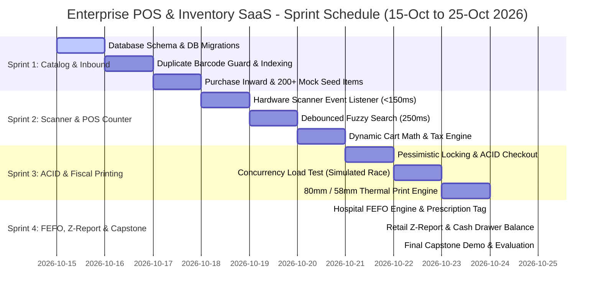

# Enterprise POS & Inventory Management SaaS
### High-Performance Multi-Tenant Point of Sale for Retail Supermarkets & Hospital Pharmacies

[](file:///e:/OJT's%20task/README.md)
[-green.svg)](file:///e:/OJT's%20task/DATABASE_SCHEMA.sql)
[](file:///e:/OJT's%20task/ARCHITECTURE.md)
[](file:///e:/OJT's%20task/DESIGN.md)

---

## 1. Executive Summary & Project Objectives

The **Enterprise POS & Inventory Management SaaS** is an industrial-grade, multi-tenant software system designed for dual-domain deployment: **Retail Supermarkets** and **Hospital Pharmacies**. The system bridges the gap between hardware peripherals (high-speed barcode scanners, cash drawers, thermal receipt printers) and resilient backend transactional systems (row-level locking, atomic inventory deductions, FEFO expiration routing, and fiscal Z-reports).

### Target Operational Domains
1. **Retail Supermarket Marts:** High-throughput barcode scanning, split promotions/discounts, bulk SKU management, cash reconciliation, and end-of-day Z-Report cashier balancing.
2. **Hospital Pharmacy Billing:** Strict First-Expired, First-Out (FEFO) batch tracking, Medical Record (MRN) & prescription linking, attending physician tagging, narcotic/scheduled drug compliance, and lot-level recall tracking.

### Core Engineering Competencies Mastered in this OJT
- **Hardware Integration & Event Handling:** Intercepting keystroke-emulation barcode scanners with `< 150ms` ingestion latency and zero focus loss.
- **ACID Transaction Safety & Concurrency:** Preventing phantom inventory deductions and race conditions during simultaneous checkouts using PostgreSQL `SELECT ... FOR UPDATE` row-level locks.
- **Domain-Specific Algorithms:** Automating First-Expired, First-Out (FEFO) multi-batch splitting across line items.
- **Hardware-Agnostic Thermal Printing:** Constructing pixel-perfect 80mm and 58mm ESC/POS compatible thermal receipt layouts with automated browser-triggered silent printing.
- **Fiscal Auditing & Cash Reconciliation:** Designing immutable financial ledgers for cashier shift opening/closing floats and Z-Report reconciliation.

---

## 2. Project Specification & Curriculum Schedule

| Parameter | Details |
| :--- | :--- |
| **Document Version** | `1.0.0` (Production Engineering Standard) |
| **Track** | Full-Stack / Backend Engineering |
| **Starting Date** | **15-10-2026** |
| **Ending Date** | **25-10-2026** |
| **Duration** | 10 Working Days (Intensive Sprint Delivery) |
| **Target Deliverable** | Fully functional, production-ready Multi-Tenant SaaS with verified concurrency locks, barcode intake, thermal printing, and FEFO compliance |

---

## 3. Sprint Roadmap (Task Breakdown)



### Sprint 1: Inventory & Product Architecture (Days 1–3)
- **Relational Schema Design:** Normalized schema across `tenants`, `categories`, `products`, `suppliers`, `batches`, and `inventory_stocks`.
- **Duplicate Barcode Guard:** Uniqueness enforced at DB index level `(tenant_id, barcode)` and service validation layer.
- **Inbound Stock Intake (Purchase Inward):** Batch-wise receiving with cost price, selling price, expiry date, supplier invoice references, and initial quantity assignment.
- **Data Seeding:** Automated seeder provisioning 200+ realistic retail and pharmacy SKUs across varied categories and multi-batch expirations.
- **Milestone Deliverable:** CRUD APIs, Swagger documentation, and database populated with 200+ seeded records.

### Sprint 2: Scanner Integration & Live POS Counter (Days 4–6)
- **Zero-Lag Scanner Listener:** Global window listener capturing raw USB/Bluetooth HID keystrokes (inter-key delta `< 30ms`, terminating with `Enter`), bypassing input focus limitations.
- **Fallback Debounced Search:** 250ms debounced search query supporting fuzzy match across SKU, barcode, and trade/generic names.
- **Real-Time Cart Engine:** Client-side financial calculator maintaining line-item sub-totals, tiered tax brackets (e.g., standard 17%, reduced 5%, exempt), line-item discounts, and rounding with exact precision.
- **Sub-150ms Ingestion:** Instantaneous scan-to-cart injection verified via Performance Profiler.
- **Milestone Deliverable:** High-speed cashier checkout screen responding to real or simulated barcode scans.

### Sprint 3: Atomic Transactions & Fiscal Invoicing (Days 7–8)
- **ACID Transaction Pipeline:** Unified transaction boundary encapsulating Invoice creation, InvoiceItem ledger generation, Inventory decrement, and Payment audit logs.
- **Concurrency & Pessimistic Row-Level Locking:** Execution of `SELECT ... FOR UPDATE` on inventory stock and batch records to eliminate "double spend" during concurrent multi-terminal checkouts.
- **Automated Rollback Safeguard:** Automatic state rollback if payment gateway fails, inventory runs dry, or any batch runs negative.
- **Thermal Receipt Engine (80mm & 58mm):** Pure CSS `@media print` thermal formatting matching ESC/POS printer paper widths with itemized taxes, cashier ID, and receipt barcodes.
- **Milestone Deliverable:** Concurrency test suite simulating 20 simultaneous threads attempting to purchase the last unit, proving zero negative inventory.

### Sprint 4: Domain Specialization & Final Capstone (Days 9–10)
- **Hospital Pharmacy Module (FEFO Logic):** First-Expired, First-Out automatic batch resolution. When scanning a generic or barcode, the system automatically draws from the earliest expiring valid batch. Multi-batch splitting when item quantity spans across two expiring lots.
- **Doctor & Patient Tagging:** Capturing Patient MRN, Patient Name, Prescription Number, Doctor Name, and License ID on pharmacy invoices.
- **Retail Mart Module (Z-Report):** End-of-day register closure generating total cash in drawer, card receivables, voided transactions, tax summary, gross margins, and cash over/short variance.
- **Low Stock Notification:** Real-time visual alerts and trigger hooks when stock drops below Reorder Point (ROP).
- **Milestone Deliverable:** Production deployment, end-to-end live demo, and complete architectural documentation.

---

## 4. Technical Evaluation Rubric for Mentors

Mentors evaluate trainees against four objective engineering benchmarks (Total: 100%):

| Metric | Weight | Passing Benchmark | Verification Method |
| :--- | :---: | :--- | :--- |
| **Transaction Safety & Concurrency** | **30%** | Zero phantom inventory deductions; 100% rollback on failure; no negative stock under concurrent checkout load. | Automated concurrent load script (`loadtest.ts` / k6 / autocannon) targeting 20 concurrent threads against 1 stock unit. |
| **Scanner Latency & UX** | **25%** | Item ingestion latency **< 150ms** from scanner `Enter` to cart update; zero focus loss; 250ms debounced fallback search. | Browser DevTools Performance profiling + hardware scanner benchmark. |
| **Domain Business Logic (FEFO & Z-Report)** | **25%** | FEFO engine selects earliest expiry batch; splits across batches accurately; Z-Report balances cash/card receipts to the penny. | Batch edge-case unit tests & cashier register reconciliation test. |
| **Code Quality, Architecture & Documentation** | **20%** | Clean layered architecture (Controller $\rightarrow$ Service $\rightarrow$ Repository); strictly typed models; complete OpenAPI specs; clean Git commit history. | Senior peer review, lint validation, and architectural review. |

---

## 5. Hardware Scanner Configuration & Emulation Guide

### A. Physical Barcode Scanners (USB / Wireless 2.4GHz / Bluetooth)
Standard industrial handheld scanners (Zebra, Honeywell, Datalogic, Netum) operate in **HID (Human Interface Device) Keyboard Emulation Mode**:
1. Scanners emit alphanumeric ASCII characters rapidly (`10ms` to `25ms` per character).
2. The scan stream concludes with a terminating suffix character, usually `Enter` (`\n` or `\r`).
3. **No Special Driver Required:** The scanner appears to the operating system as a fast typing keyboard.
4. **Configuration Barcodes:** Ensure the scanner's user manual is configured to send `CR` (`Carriage Return`) or `CR+LF` as the postamble suffix.

### B. Mobile Phone Emulation (No Hardware Scanner Required)
If physical scanners are unavailable during development, trainees can use mobile apps to simulate an HID Bluetooth keyboard:
- **Barcode to PC:** Available for Android and iOS. Connects over Wi-Fi or Bluetooth to transmit camera-scanned barcodes directly as machine keystrokes.
- **Keyboard Scanner Apps:** Configure the app to append a newline (`Enter`) character after every barcode scan.
- **Browser Mock Utility:** The included UI contains a built-in virtual hardware scanner emitter (`Ctrl + K` or floating drawer) that fires rapid synthetic `keydown` events matching hardware scan timings.

---

## 6. Thermal Receipt Printer Specification (ESC/POS)

Receipt output supports standard point-of-sale thermal printers (Epson, Star Micronics, Xprinter, Bixolon):

### Print Standards
- **80mm Paper Width:** 576 dots per line (approx. 48 characters per line standard font). Ideal for supermarket invoices with detailed item descriptions and multi-column tables.
- **58mm Paper Width:** 384 dots per line (approx. 32 characters per line). Compact format ideal for pharmacy express checkout slips.
- **CSS Print Architecture:** Styled via `@media print` with exact `@page { size: 80mm auto; margin: 0; }` to eliminate browser headers/footers and margins.

---

## 7. Recommended Technology Stack

- **Backend:** Node.js (TypeScript) / Express or Fastify / NestJS OR Go / Python FastAPI.
- **Database:** PostgreSQL 15+ (required for explicit `SELECT ... FOR UPDATE`, row-level locking, and transactional savepoints).
- **Frontend:** React / Vite / TypeScript with Vanilla CSS / Modern CSS variables (no bloated frameworks required for high-speed POS counters).
- **ORM / Query Engine:** Prisma, Drizzle ORM, or Raw pg-pool SQL (strongly recommended for explicit transaction control).
- **Documentation:** OpenAPI 3.0 (Swagger), Mermaid ERDs, Markdown Architecture.

---

## 8. Directory Structure Overview

```text
e:/OJT's task/
├── README.md                      # Executive summary, curriculum, sprint roadmap & evaluation
├── ARCHITECTURE.md                # System architecture, DDD boundaries, ERD & locking models
├── DESIGN.md                      # UI/UX specification, scanner buffer engine, thermal CSS
├── DATABASE_SCHEMA.sql            # PostgreSQL DDL, constraints, triggers & concurrency queries
├── API_SPECIFICATION.md           # RESTful API contracts & OpenAPI schemas
├── docs/
│   └── SPRINT_PLAN_AND_TASKS.md   # Day-by-day (15-Oct to 25-Oct) trainee task guide & milestones
```

---

## 9. Quick Start Guide

### 1. Database Setup
```bash
# Connect to PostgreSQL and execute the schema
psql -U postgres -d postgres -c "CREATE DATABASE pos_inventory_db;"
psql -U postgres -d pos_inventory_db -f DATABASE_SCHEMA.sql
```

### 2. Verify Database Integrity
```sql
-- Verify seeded products and batches
SELECT p.name, p.barcode, b.batch_number, b.expiry_date, s.quantity
FROM products p
JOIN batches b ON p.id = b.product_id
JOIN inventory_stocks s ON b.id = s.batch_id
ORDER BY b.expiry_date ASC;
```

---

## 10. OJT Coordinator & Mentor Contact

- **Program Track:** Enterprise Full-Stack & Systems Engineering
- **Target Deliverable Window:** 15-10-2026 to 25-10-2026
- **Reference Standard:** POS-INV-SaaS-V1.0
